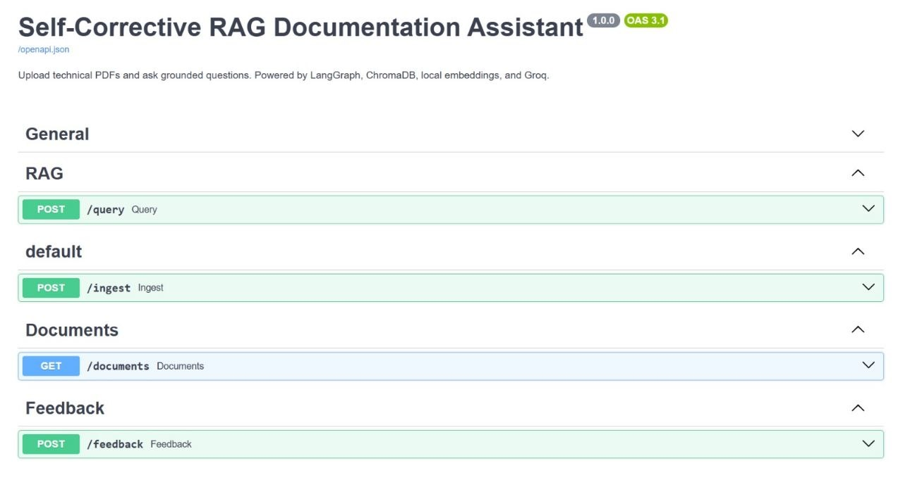
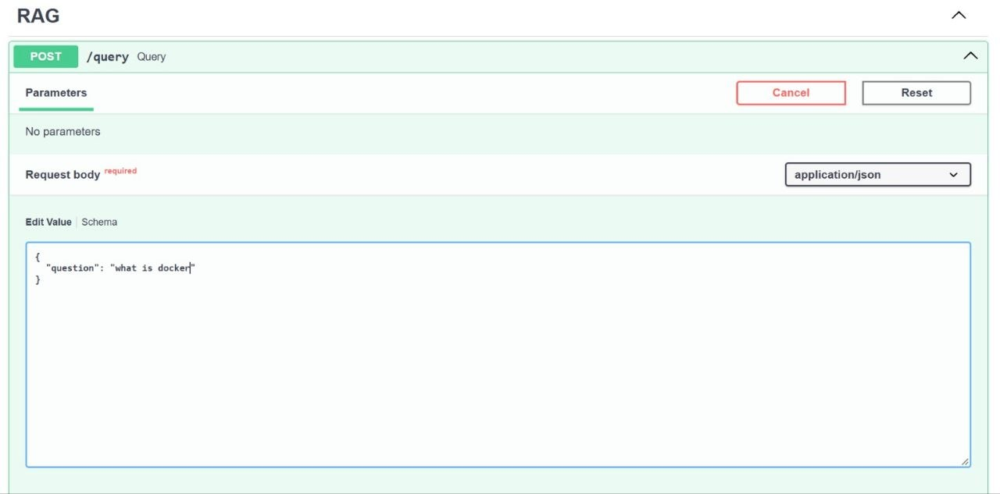
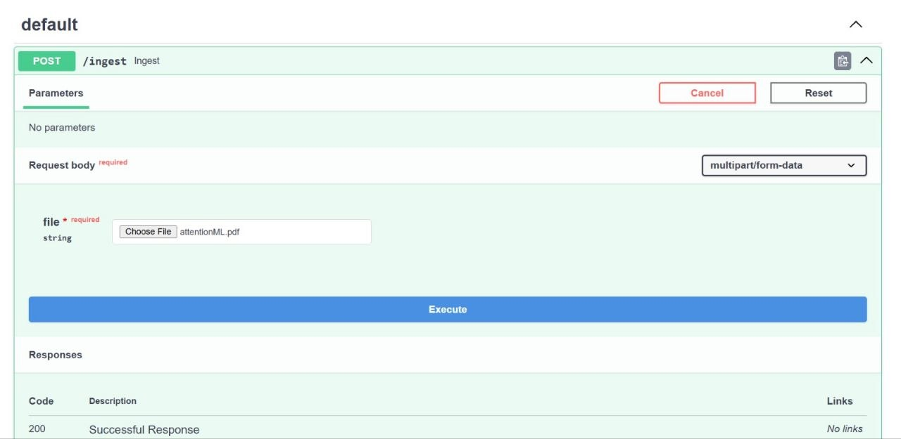
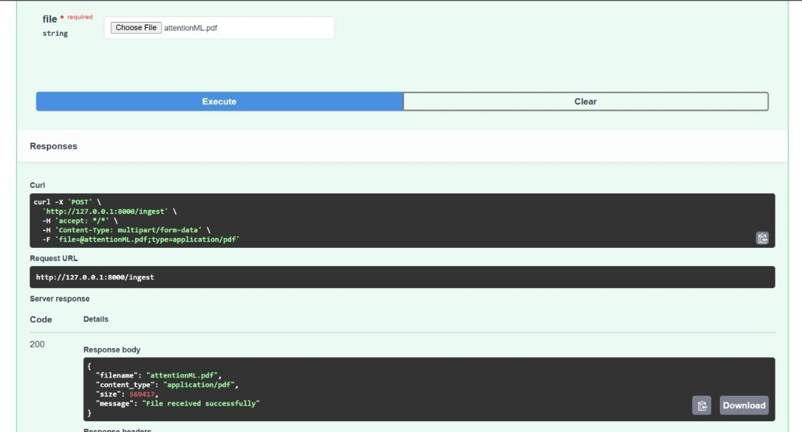

# Express Analytics Assignment
## Document Question Answering System using Retrieval-Augmented Generation (RAG)

## 1. Project Overview

This project implements a document question-answering application using Retrieval-Augmented Generation (RAG). It allows users to ask questions and receive answers grounded in retrieved document content.

Instead of relying only on the language model's internal knowledge, the system retrieves relevant document chunks from a vector database and supplies them as context for answer generation.

The project combines document processing, semantic search, vector storage, and large language model generation in a modular workflow.

### Objectives

- Process documents into searchable text chunks.
- Generate embeddings for semantic retrieval.
- Retrieve relevant information from a vector database.
- Generate context-grounded answers using an LLM.
- Expose application functionality through REST APIs.
- Handle questions when relevant context is unavailable.

## 2. Key Features

- Document loading support for PDF, TXT, Markdown, and HTML.
- URL-based document loading in the ingestion module.
- Text splitting with configurable chunk size and overlap.
- Semantic retrieval using sentence-transformer embeddings.
- Persistent vector storage using ChromaDB.
- RAG workflow orchestration using LangGraph.
- LLM integration through the Groq API.
- FastAPI endpoints for querying, health checks, document listing, and feedback.
- Feedback storage using JSON Lines format.
- Relevance grading and no-answer handling in the RAG workflow.

## 3. Technology Stack

| Technology | Purpose |
|---|---|
| Python | Core application logic |
| FastAPI | REST API framework |
| LangGraph | RAG workflow orchestration |
| LangChain | Document loading and text splitting |
| Groq API | Language model inference |
| Llama 3.3 70B Versatile | Configured default language model |
| Sentence Transformers | Text embedding generation |
| ChromaDB | Vector storage and similarity search |
| Uvicorn | ASGI application server |
| JSON / JSONL | Document metadata and feedback storage |

## 4. System Architecture

The application follows a modular Retrieval-Augmented Generation architecture.

```text
                  User Question
                        |
                        v
                 FastAPI Endpoint
                        |
                        v
                  Query Analysis
                        |
                        v
                 Semantic Retrieval
                        |
                        v
                 Document Grading
                        |
               +--------+--------+
               |                 |
        Relevant Context   Insufficient Context
               |                 |
               v                 v
       Answer Generation      No-Answer Path
               |                 |
               +--------+--------+
                        |
                        v
                 API Response
                        |
                        v
                 Answer and Sources
```

### Architecture Components

**1. Document Processing**

The ingestion module supports loading document content from supported file formats and URLs. The content can then be split into smaller chunks for retrieval.

**2. Embedding Generation**

The embedding model `sentence-transformers/all-MiniLM-L6-v2` converts text into numerical vector representations.

**3. Vector Storage**

ChromaDB stores document embeddings and associated metadata, enabling semantic similarity search.

**4. Retrieval**

When a user asks a question, the system retrieves relevant document chunks from the vector database.

**5. Document Grading**

The workflow evaluates the relevance of retrieved documents before generating an answer.

**6. Answer Generation**

The retrieved context is passed to the configured Groq language model to generate a context-grounded answer.

**7. No-Answer Handling**

If the retrieved information is insufficient, the workflow can follow a no-answer path rather than generating an unsupported response.

## 5. RAG Workflow

The LangGraph workflow contains the following nodes:

| Node | Responsibility |
|---|---|
| `query_analysis` | Analyzes the user's question |
| `retrieval` | Retrieves relevant document chunks |
| `document_grading` | Evaluates the relevance of retrieved documents |
| `generation` | Generates an answer using the retrieved context |
| `no_answer` | Handles cases where sufficient context is unavailable |

This modular workflow separates question analysis, retrieval, relevance evaluation, and answer generation.

## 6. Project Output

The following screenshots demonstrate the application's output.

### Output 1



### Output 2



### Output 3



### Output 4



## 7. Environment Setup

### Prerequisites

- Python installed on your system.
- pip package manager.
- A Groq API key.
- Git.

### Step 1: Clone the Repository

```bash
git clone https://github.com/AmanJha-1337/Express_Analytics_Assign.git
cd Express_Analytics_Assign
```

### Step 2: Create a Virtual Environment

**Windows**

```bash
python -m venv venv
venv\Scripts\activate
```

**macOS/Linux**

```bash
python3 -m venv venv
source venv/bin/activate
```

### Step 3: Install Dependencies

```bash
pip install -r requirements.txt
```

### Step 4: Configure Environment Variables

Create a `.env` file in the project root.

```env
GROQ_API_KEY=your_groq_api_key
GROQ_MODEL=llama-3.3-70b-versatile
EMBEDDING_MODEL=sentence-transformers/all-MiniLM-L6-v2
CHUNK_SIZE=900
CHUNK_OVERLAP=150
TOP_K=5
MAX_RETRIES=1
```

Replace `your_groq_api_key` with your actual API key.

**Security considerations:**

- Never commit your real API key to GitHub.
- Add `.env` to `.gitignore`.
- If needed, provide a `.env.example` file containing placeholder values.

## 8. Running the Application

Run the following command from the project root:

```bash
uvicorn app.main:app --reload
```

Once the server starts, access the following local URLs:

| Resource | URL |
|---|---|
| Application root | `http://127.0.0.1:8000/` |
| Health check | `http://127.0.0.1:8000/health` |
| Interactive API documentation | `http://127.0.0.1:8000/docs` |

The interactive API documentation allows you to inspect available endpoints and test requests.

## 9. API Endpoints

The application exposes the following endpoints.

| Method | Endpoint | Purpose |
|---|---|---|
| GET | `/` | Returns basic application information |
| GET | `/health` | Checks application health |
| POST | `/query` | Submits a question to the RAG workflow |
| POST | `/ingest` | Accepts an uploaded file and returns its metadata |
| GET | `/documents` | Lists document records |
| POST | `/feedback` | Records user feedback |

### 9.1 Health Check

**Request**

```http
GET /health
```

**Example cURL request**

```bash
curl http://127.0.0.1:8000/health
```

The endpoint returns the health status defined by the application.

### 9.2 Submit a Question

**Request**

```http
POST /query
Content-Type: application/json
```

**Example request body**

```json
{
  "question": "What is the main topic of the document?"
}
```

**Example cURL request**

```bash
curl -X POST "http://127.0.0.1:8000/query" \
  -H "Content-Type: application/json" \
  -d "{\"question\":\"What is the main topic of the document?\"}"
```

**Illustrative response format**

```json
{
  "answer": "The document discusses its main topic and supporting details.",
  "sources": []
}
```

This is an illustrative example, not a guaranteed response. The actual answer and source fields depend on the indexed documents and the response schema.

### 9.3 Upload a Document

**Request**

```http
POST /ingest
```

**Example cURL request**

```bash
curl -X POST "http://127.0.0.1:8000/ingest" \
  -F "file=@sample.pdf"
```

**Current implementation note:** The endpoint accepts the uploaded file and returns metadata such as its filename, content type, and size. It does not currently save or index the uploaded content into ChromaDB.

### 9.4 List Documents

**Request**

```http
GET /documents
```

**Example cURL request**

```bash
curl http://127.0.0.1:8000/documents
```

The endpoint returns document records maintained by the application.

### 9.5 Submit Feedback

**Request**

```http
POST /feedback
Content-Type: application/json
```

The request body must match the `FeedbackRequest` schema defined in `app/schemas.py`.

Use the interactive API documentation at `/docs` to inspect the required fields and test the endpoint.

Feedback is stored in JSON Lines format for later inspection.

## 10. Design Decisions and Trade-offs

### 10.1 Chunk Size and Overlap

The default configuration uses a chunk size of 900 characters and an overlap of 150 characters.

**Benefits**
- Overlap helps preserve context across chunk boundaries.
- Chunking makes retrieval more focused than searching an entire document at once.

**Trade-offs**
- Smaller chunks can improve retrieval precision but may lose surrounding context.
- Larger chunks preserve more context but can include irrelevant information.

### 10.2 Embedding Model

The application uses `sentence-transformers/all-MiniLM-L6-v2`.

**Benefits**
- Lightweight and suitable for semantic retrieval.
- Can generate embeddings without requiring a hosted embedding API.

**Trade-offs**
- Retrieval quality varies by domain and question type.
- A domain-specific embedding model may perform better for specialized documents.

### 10.3 ChromaDB

ChromaDB provides persistent vector storage.

**Benefits**
- Supports semantic similarity search.
- Provides local persistent storage.

**Trade-offs**
- Retrieval quality depends on the embedding model, chunking strategy, and search configuration.
- Large-scale deployments may require additional infrastructure and optimization.

### 10.4 Groq API

The application uses a hosted language model through the Groq API.

**Benefits**
- Avoids running a large language model locally.
- Simplifies integration with LLM-based answer generation.

**Trade-offs**
- Requires API credentials and internet access.
- Availability, latency, and usage limits depend on the provider.

### 10.5 LangGraph Workflow

The RAG pipeline separates query analysis, retrieval, document grading, and answer generation.

**Benefits**
- Makes the workflow modular and easier to extend.
- Supports explicit handling of insufficient context.

**Trade-offs**
- Additional workflow steps increase implementation complexity.
- Extra processing may increase response latency.

### 10.6 No-Answer Handling

The workflow includes a path for questions that cannot be supported by the retrieved context.

**Benefits**
- Helps reduce unsupported answers.
- Encourages context-grounded responses.

**Trade-offs**
- Incorrect relevance grading may reject information that could have been useful.
- Retrieval and grading quality should be evaluated using representative questions.

## 11. Limitations and Future Improvements

Potential improvements include:

1. Connect the upload endpoint to the full document ingestion and indexing pipeline.
2. Add file validation, size limits, and clearer error handling.
3. Return richer source metadata, including document names and relevant text chunks.
4. Add automated tests for API endpoints and RAG workflow nodes.
5. Evaluate retrieval quality using a representative question-and-answer dataset.
6. Add authentication and rate limiting before public deployment.
7. Improve logging and monitoring for retrieval and generation failures.
8. Build a frontend for document management, question answering, and feedback.

## 12. Conclusion

This project demonstrates a modular RAG-based question-answering backend that combines document processing, semantic retrieval, vector storage, and LLM-based generation.

The implementation provides a foundation for building document-grounded AI applications. It also identifies opportunities to improve ingestion, retrieval evaluation, source attribution, and reliability.

## 13. Repository

**GitHub Repository:**  
https://github.com/AmanJha-1337/Express_Analytics_Assign

**Author:** Aman Kumar Jha
