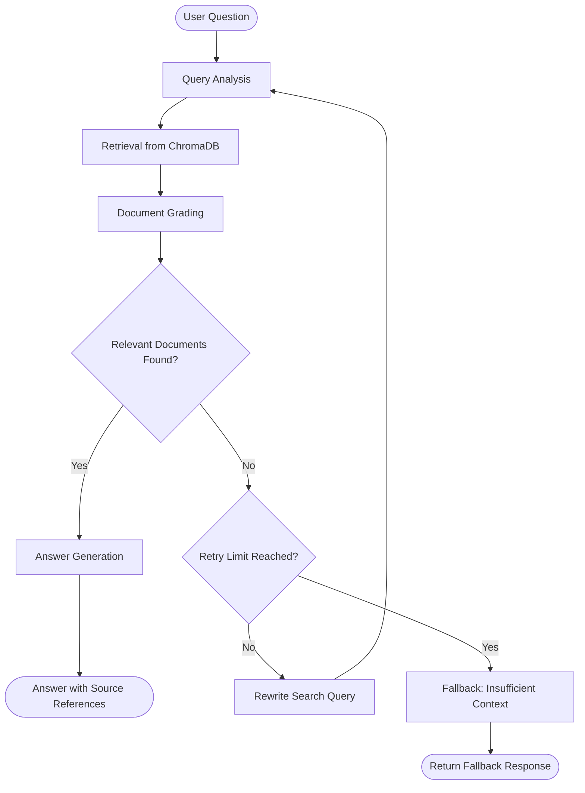

# Self-Corrective RAG Documentation Assistant

A Retrieval-Augmented Generation (RAG) application that answers questions from technical documentation using a LangGraph workflow, ChromaDB vector retrieval, Hugging Face embeddings, Groq-powered language models, and a FastAPI backend.

The system retrieves relevant document passages, evaluates their relevance, rewrites the search query when retrieval is insufficient, and generates answers grounded in the available context.

## Project Overview

Technical documentation can be lengthy and difficult to search manually. This project provides a question-answering system over an indexed corpus of technical documents.

The application follows a self-corrective RAG approach:

1. A user submits a technical question.
2. The question is rewritten into a retrieval-friendly search query.
3. ChromaDB retrieves the most similar document chunks.
4. An LLM grades each retrieved passage for relevance.
5. Relevant passages are passed to the answer-generation node.
6. If no relevant passages are found, LangGraph rewrites the query and retries retrieval, subject to a retry limit.
7. If the available context remains insufficient, the system returns a fallback response instead of guessing.

## Key Features

- **Query analysis:** Rewrites the user's question to improve semantic retrieval.
- **Semantic search:** Retrieves document chunks from a persistent ChromaDB collection.
- **Document grading:** Uses an LLM to classify retrieved passages as relevant or irrelevant.
- **Self-correction:** Rewrites the query and retries retrieval when no relevant passages are found.
- **Grounded generation:** Instructs the LLM to answer using only the retrieved context.
- **Source references:** Includes source filenames and page references in generated answers where available.
- **Document processing module:** Supports PDF, TXT, Markdown, and HTML parsing, along with URL-based HTML ingestion through the ingestion module.
- **REST API:** Exposes question answering, document listing, feedback, and file-receiving endpoints through FastAPI.

## Technology Stack

| Component | Technology |
|---|---|
| Programming language | Python |
| Workflow orchestration | LangGraph |
| LLM integration | LangChain Groq |
| Language model | Llama 3.3 70B Versatile (configurable) |
| Embedding model | Sentence Transformers — `all-MiniLM-L6-v2` |
| Vector database | ChromaDB |
| Document processing | PyMuPDF, BeautifulSoup |
| Text splitting | RecursiveCharacterTextSplitter |
| API framework | FastAPI |
| API server | Uvicorn |
| Configuration | python-dotenv |

## System Architecture

The application has two main parts: a document-ingestion/indexing pipeline and a question-answering workflow.

### 1. Document Ingestion and Indexing

The ingestion module extracts text, splits documents into chunks, generates embeddings through the configured embedding model, and stores the chunks in ChromaDB.

```text
Documents / URLs
       |
       v
Document Loading
(PDF / TXT / MD / HTML / URL)
       |
       v
Text Extraction
       |
       v
Recursive Character Text Splitter
       |
       v
Document Chunks + Metadata
       |
       v
Hugging Face Embeddings
       |
       v
ChromaDB Vector Store
```

Supported local document formats in the ingestion module:

- PDF
- TXT
- Markdown
- HTML

The URL loader extracts readable text from HTML pages.

### 2. Self-Corrective LangGraph RAG Workflow

The question-answering workflow is implemented as a LangGraph `StateGraph`.



#### Workflow Nodes

| Node | Responsibility |
|---|---|
| Query Analysis | Rewrites the original question into a concise search query. On a retry, it creates a broader query with useful synonyms. |
| Retrieval | Performs similarity search in ChromaDB and returns the top-k document chunks. |
| Document Grading | Uses the Groq LLM to evaluate each retrieved passage as relevant or irrelevant. |
| Generation | Generates an answer using the relevant retrieved context and asks the model to include source references. |
| No Answer | Returns a fallback message when relevant information cannot be found within the retry limit. |

#### State Management

The LangGraph state uses a `TypedDict` schema to carry information between nodes.

| State field | Purpose |
|---|---|
| `question` | Original user question |
| `search_query` | Current rewritten query used for retrieval |
| `documents` | Retrieved document chunks |
| `relevant_documents` | Chunks that pass relevance grading |
| `retry_count` | Number of unsuccessful retrieval attempts |
| `answer` | Generated answer or fallback response |

The retry count is updated when document grading finds no relevant passages. A conditional edge then decides whether to generate an answer, repeat query analysis, or return the fallback response.

## Document Chunking and Embedding Strategy

### Chunking

The project uses LangChain's `RecursiveCharacterTextSplitter`.

| Parameter | Default value |
|---|---:|
| Chunk size | 900 characters |
| Chunk overlap | 150 characters |
| Retrieval top-k | 5 |

The splitter prioritizes paragraph and line boundaries before splitting into smaller text units:

```python
separators = ["\n\n", "\n", ". ", " ", ""]
```

**Why this strategy?**

- Recursive splitting attempts to preserve paragraph and line boundaries.
- A 900-character chunk provides a manageable passage for semantic retrieval and LLM context.
- A 150-character overlap helps retain context across neighboring chunks.
- Metadata such as source filename and PDF page number is retained for source attribution.

These values can be adjusted through environment variables.

### Embeddings

The application uses:

```text
sentence-transformers/all-MiniLM-L6-v2
```

The embedding model converts document chunks and user search queries into numerical vectors. ChromaDB uses cosine similarity to retrieve semantically similar content.

### Vector Store

ChromaDB is configured with a persistent local directory:

```text
data/chroma/
```

Indexed vectors are retained between application restarts.

## Project Structure

```text
Express_Analytics_Assign/
|
|-- app/
|   |-- __init__.py
|   |-- config.py          # Environment variables and configuration
|   |-- ingestion.py       # Document loading, parsing, splitting and indexing
|   |-- main.py            # FastAPI application and endpoints
|   |-- rag_graph.py       # LangGraph RAG workflow and nodes
|   |-- schemas.py         # Pydantic request and response schemas
|   |-- vectorstore.py     # Hugging Face embeddings and ChromaDB setup
|
|-- data/
|   |-- uploads/           # Intended location for uploaded documents
|   |-- chroma/            # Persistent vector database (created at runtime)
|   |-- documents.json     # Document manifest (created during indexing)
|   |-- feedback.jsonl     # Feedback records (created after feedback submission)
|
|-- docs/
|   |-- fastapi_basics.md
|   |-- langgraph_overview.md
|   |-- pydantic_validation.md
|   |-- python_typing.md
|
|-- requirements.txt
|-- .gitignore
|-- README.md
|-- .env                  # Create locally; do not commit secrets
```

## Installation and Setup

### Prerequisites

- Python 3.10 or later
- pip
- A Groq API key

### 1. Clone the repository

```bash
git clone https://github.com/AmanJha-1337/Express_Analytics_Assign.git
cd Express_Analytics_Assign
```

### 2. Create and activate a virtual environment

**Windows:**

```bash
python -m venv venv
venv\Scripts\activate
```

**macOS / Linux:**

```bash
python -m venv venv
source venv/bin/activate
```

### 3. Install dependencies

```bash
pip install -r requirements.txt
```

### 4. Configure environment variables

Create a `.env` file in the project root:

```env
GROQ_API_KEY=your_groq_api_key_here

GROQ_MODEL=llama-3.3-70b-versatile
EMBEDDING_MODEL=sentence-transformers/all-MiniLM-L6-v2

CHUNK_SIZE=900
CHUNK_OVERLAP=150
TOP_K=5
MAX_RETRIES=1
```

Get an API key from the [Groq Console](https://console.groq.com/).

**Important:** Never commit your actual API key or `.env` file to GitHub.

### 5. Index the bundled Markdown corpus

The repository includes four Markdown documents in `docs/`. The ingestion functions are implemented in `app/ingestion.py`; the current FastAPI upload route does not automatically call them. To index the bundled Markdown corpus, run this command from the repository root:

```bash
python -c "from pathlib import Path; from app.ingestion import ingest_saved_file; [print(ingest_saved_file(p)) for p in Path('docs').glob('*.md')]"
```

The first run may download the Sentence Transformers embedding model. Indexed vectors are stored under `data/chroma/`, and the document manifest is written to `data/documents.json`.

### 6. Run the application

From the repository root:

```bash
uvicorn app.main:app --reload
```

The API will be available at:

```text
http://127.0.0.1:8000
```

Interactive Swagger documentation:

```text
http://127.0.0.1:8000/docs
```

## API Documentation

The FastAPI application defines the following endpoints.

| Method | Endpoint | Purpose |
|---|---|---|
| GET | `/` | API welcome message |
| GET | `/health` | Basic health check |
| POST | `/query` | Submit a question to the RAG workflow |
| POST | `/ingest` | Receive an uploaded file and return its metadata |
| GET | `/documents` | List documents recorded in the ingestion manifest |
| POST | `/feedback` | Save thumbs-up or thumbs-down feedback |

### 1. Home

**Request**

```http
GET /
```

**Example response**

```json
{
  "message": "RAG Documentation Assistant is running.",
  "docs": "/docs",
  "upload_hint": "Use POST /ingest in Swagger UI to upload PDF files."
}
```

### 2. Health Check

**Request**

```http
GET /health
```

**Example response**

```json
{
  "status": "ok"
}
```

### 3. Query

**Request**

```http
POST /query
Content-Type: application/json
```

**Request body**

```json
{
  "question": "What is LangGraph and how does a StateGraph work?"
}
```

**Example response structure**

```json
{
  "question": "What is LangGraph and how does a StateGraph work?",
  "answer": "Answer generated from the retrieved documentation, with source references.",
  "sources": [
    {
      "source": "langgraph_overview.md",
      "page": null,
      "chunk_id": "langgraph_overview.md:1",
      "excerpt": "Relevant retrieved text..."
    }
  ],
  "retries": 0
}
```

The answer and source details depend on the indexed corpus and model response. This example illustrates the response structure; it is not a captured live result.

### 4. Ingest

**Request**

```http
POST /ingest
Content-Type: multipart/form-data
```

Example request using cURL:

```bash
curl -X POST "http://127.0.0.1:8000/ingest" \
  -F "file=@sample.pdf"
```

**Current implementation note:** The present `/ingest` route receives the uploaded file and returns its filename, content type, and size. It does not yet save or index that upload. The document parsing and indexing functionality is implemented separately in `app/ingestion.py`.

### 5. List Documents

**Request**

```http
GET /documents
```

**Example response structure**

```json
{
  "count": 1,
  "documents": [
    {
      "filename": "langgraph_overview.md",
      "chunks": 3,
      "type": "md",
      "added_at": "2026-11-01T10:00:00+00:00"
    }
  ]
}
```

This is an illustrative response. The endpoint returns the current document manifest.

### 6. Feedback

**Request**

```http
POST /feedback
Content-Type: application/json
```

**Request body**

```json
{
  "question": "What is LangGraph?",
  "answer": "LangGraph is a framework for building stateful graph-based workflows.",
  "rating": "up",
  "comment": "The answer was useful."
}
```

The `rating` field accepts `up` or `down`. Feedback is appended to `data/feedback.jsonl`.

## Design Decisions and Trade-offs

### 1. LangGraph for workflow orchestration

A graph-based workflow makes each RAG stage explicit and allows conditional routing after document grading. This is useful for implementing self-correction without mixing retrieval, evaluation, and generation into one function.

### 2. ChromaDB for vector storage

ChromaDB provides local persistent vector storage and integrates with LangChain. It keeps the prototype straightforward to run without provisioning a separate vector database server.

### 3. Local sentence-transformer embeddings

The `all-MiniLM-L6-v2` embedding model avoids dependence on a paid embedding API. It can run locally on CPU, with a corresponding inference-time trade-off.

### 4. Groq for LLM inference

Groq provides the chat model used for query rewriting, relevance grading, and answer generation. The API key is read from an environment variable rather than hard-coded.

### 5. Context-grounded generation

The generation prompt instructs the model to use only the retrieved documentation and to state when the context does not contain the answer. This reduces the risk of unsupported answers, although it does not guarantee that every generated claim is correct.

### 6. Bounded retries

The retry limit prevents the graph from looping indefinitely when the corpus does not contain relevant information. A fallback response is returned after unsuccessful retrieval attempts.

## Assumptions and Limitations

- The indexed corpus is the source of truth for answering questions; the system does not currently use an external web-search fallback.
- The current API upload route receives a file but is not yet connected to the file-saving and indexing pipeline.
- Local-file parsing/indexing and URL parsing/indexing functions are implemented in the ingestion module, but no API endpoint currently invokes URL ingestion.
- The document manifest is maintained by the ingestion module and lists successfully indexed sources.
- The LLM-based relevance grader evaluates retrieved chunks individually. Its decisions can be imperfect.
- Source references are based on document metadata supplied during ingestion.
- The generation prompt encourages grounded responses, but a separate answer-groundedness verification node is not implemented.
- Conversation memory and a dedicated frontend are not part of the current implementation.

## Future Improvements

1. Connect `POST /ingest` to the existing file-saving and indexing pipeline, including file-size and file-type validation.
2. Add URL ingestion through the API.
3. Add automated tests for ingestion, graph routing, retrieval, and API endpoints.
4. Add a groundedness-check node to verify generated answers against retrieved passages.
5. Introduce structured logging and more detailed operational monitoring.
6. Add session-based conversation memory for follow-up questions.
7. Add authentication, upload security controls, and stricter CORS configuration before deployment.
8. Consider hybrid retrieval or reranking to improve retrieval quality on technical content.

## Quick Start

```bash
# Clone the repository
git clone https://github.com/AmanJha-1337/Express_Analytics_Assign.git
cd Express_Analytics_Assign

# Create and activate an environment (Windows)
python -m venv venv
venv\Scripts\activate

# Install dependencies
pip install -r requirements.txt

# Create a .env file and add GROQ_API_KEY

# Index the bundled Markdown documents
python -c "from pathlib import Path; from app.ingestion import ingest_saved_file; [print(ingest_saved_file(p)) for p in Path('docs').glob('*.md')]"

# Start the API
uvicorn app.main:app --reload
```

Open `http://127.0.0.1:8000/docs` to explore the API.

## Author

**Aman Kumar Jha**  
GitHub: [AmanJha-1337](https://github.com/AmanJha-1337)  
Project Repository: [Express_Analytics_Assign](https://github.com/AmanJha-1337/Express_Analytics_Assign)

---

Developed as a take-home assignment for the **AI/ML Engineer Intern – Express Analytics** selection process.
